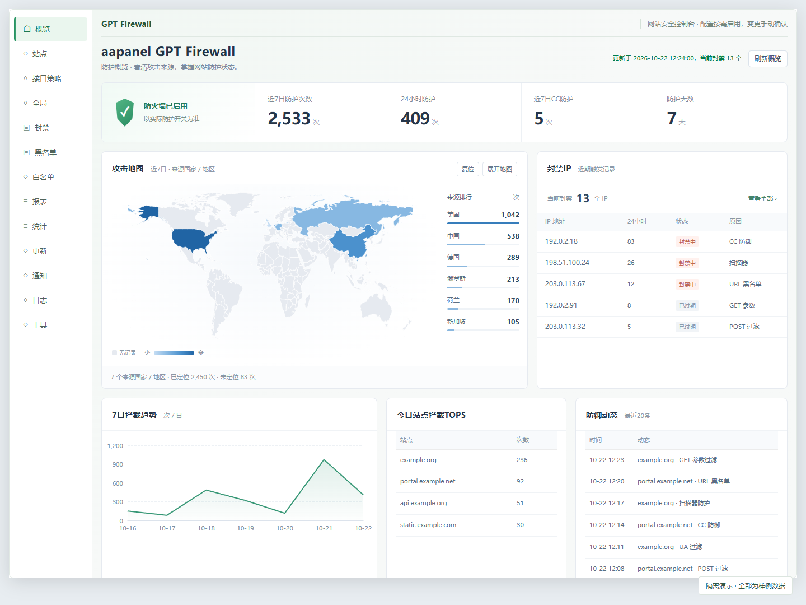
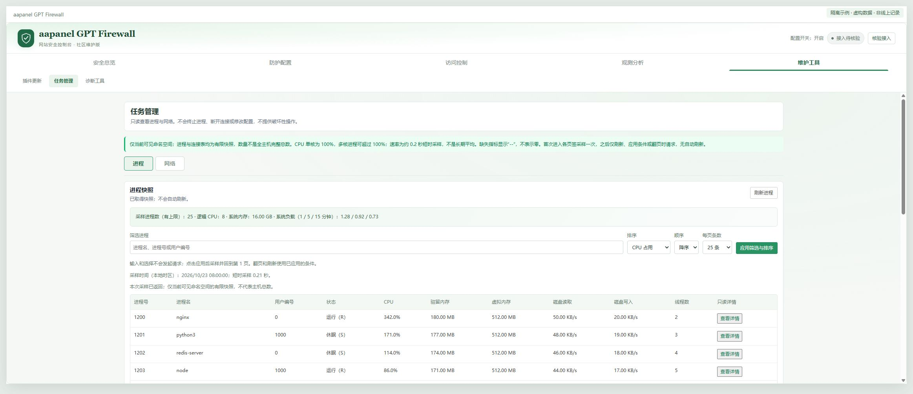
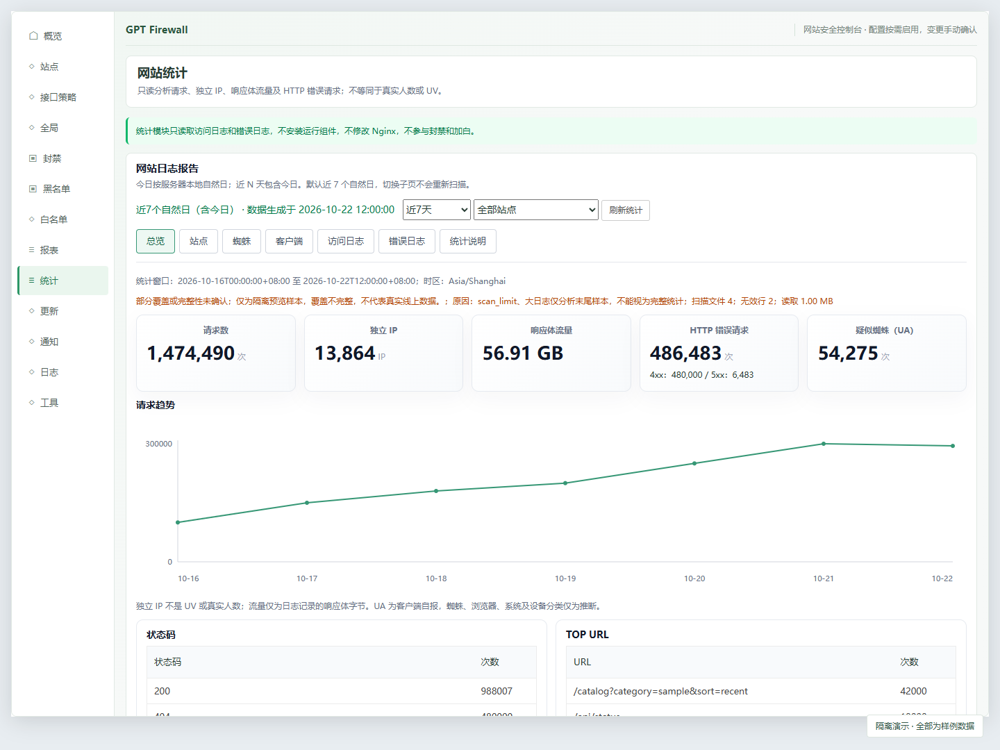

# aapanel GPT Firewall

> **下载状态：v0.1.10 的发布记录和升级附件已撤回，当前不提供该版下载。** 请以发布页仍公开的具体版本、说明与附件为准，不使用缓存中的旧下载链接。仓库源码不等于已发布安装包，后续修复尚未发布。

> **v0.1.10：风险 IP 封禁建议、重复封禁多站点批量配置与现有问题修复。** 建议只在手动分析后显示，需人工确认才封所选站点；不自动开启新防护。延续已核验的国内第三方 `free_waf 8.4` 兼容，不是宝塔官方 WAF，不支持空机器首次安装。

面向**运行 Lua 指纹已核验且数据完整的国内第三方 `free_waf 8.4` 或已知社区版**的非官方中文兼容升级，当前源码版本标识为 **v0.1.10（发布已撤回，后续修复未发布）**。国内兼容从 v0.1.9 开始提供，未撤回的历史附件保持不变；`8.4` 是原插件版本，实测面板为 `12.0.0`。纯 aaPanel 5.0 原始指纹尚未验证，不能笼统宣称完整支持 5.0。已停用或尚未接入 Nginx 的已识别完整旧安装可只更新代码，不自动启用防护。

本项目不收费，不需要模型 API 密钥或订阅，也不通过实时语言模型判断线上请求。实验性兼容代码应先在恢复出的测试环境验证；源码可读不代表存在对应的可安装发布。

[发布与下载](https://github.com/137985990/aapanel-gpt-firewall/releases) · [升级与恢复](docs/UPGRADE.md) · [更新管理](docs/UPDATES.md) · [更新记录](CHANGELOG.md) · [安全说明](SECURITY.md) · [问题反馈](https://github.com/137985990/aapanel-gpt-firewall/issues)

需要 AI agent 协助安装或升级时，先让它阅读 [Agent 安装升级清单](docs/UPGRADE.md#agent-安装升级清单)。源码根目录另有 `AGENTS.md` 自动发现入口；升级 ZIP 为兼容既有更新器不新增该文件，完整执行清单随包保存在 `docs/UPGRADE.md`。

这不是 aaPanel、宝塔或 OpenAI 的官方产品。**不支持空机器首次安装，拒绝未知／自定义／付费 WAF；不能按“8.x”版本号直接覆盖。** 内部插件名仍为 `free_waf`，不要改名或并排安装第二个插件。



截图来自本仓库的隔离测试环境，样例日期以各图标注为准，不展示生产站点或真实用户。截图不是生产验收报告。

## 国内宝塔兼容矩阵

| 项目 | 已核验范围 |
| --- | --- |
| 原插件 | 国内第三方 `free_waf 8.4`，原作者 **明国三年一场雨**；必须匹配已核验 Lua SHA256 |
| 面板／Python | 宝塔面板 `12.0.0` ／面板 Python `3.7.16` |
| Nginx／系统 | 宝塔 Nginx `1.28.3` ／ Debian `12` |
| 目标与边界 | GPT `0.1.10`，固定 21 个运行受管文件；兼容结论仅限下列受测流程 |
| 兼容验证 | 原版 8.4 → GPT → 还原 8.4 → GPT；两条受测拦截路径返回 403，正常请求与 JSON POST 返回 200 |
| 尚未证明 | 其他面板／Python／Nginx／系统矩阵、纯 aaPanel 5.0 原始指纹、全部站点与全部防护语义 |

来源识别采用严格 Lua 指纹，不靠版本、品牌或注释猜测；未知默认拒绝。JSON POST 200 仅证明受测请求正常，不证明 JSON 正文获得完整检测。原版迁移显式新增缺失的 `url_black`（沿用 `get.status`）、`compatibility_profile`、`site_aliases` 与站点 `disable_rule.header`；只允许补齐三个已确认缺失空表，不重置其他配置。JSON／上传、蜘蛛 PTR 验证、算术挑战及封禁行为不作等价承诺。完整迁移项和拒绝条件见 [国内 8.4 迁移边界](docs/UPGRADE.md#国内-84-迁移边界)。

首次原版升级前必须独立备份并暂停管理写操作，旧管理器不遵守新锁。商城可能仍显示旧名，且把上游 `8.4` 与项目 `0.1.10` 比较后提示更新；**不要点击旧商城更新覆盖**，后续使用“维护工具 → 插件更新”的 GPT 更新器。只升级到仍公开且已核验的版本，不使用已撤回附件，不覆盖同版本旧包。

## 功能一览

| 能力 | 当前提供 | 使用边界 |
| --- | --- | --- |
| 中文总览 | 趋势、来源地图、站点排行、封禁查询 | 地图依赖面板本地资源与可用地理数据库；缺少时提示降级 |
| 分组控制台 | 顶部状态栏、五组横向导航、宽屏与小屏布局 | 分组仅在本次打开期间记忆页面 |
| 手动接入核验 | 检查宝塔 Nginx 配置；受管入口还可验证本机 Lua 执行 | 不自动核验、不重载，非受管入口只有配置证据，均不代表全部站点已验收 |
| 一键修复接入 | 维护工具内手动预检、确认、备份、补齐缺失入口、测试和重载 | 不覆盖已有入口；可能使原有开启规则开始拦截。成功仅验证本机探针，不代替站点验收 |
| 原有规则管理 | IP、URL、UA、Header、Cookie、GET、POST 规则及站点例外 | 保留现有开关与阈值，不自动替换规则库 |
| CC 与注册防护 | 保留原防护；旧 CC 计数按站点和规范化路径区分，不因查询串变化重置 | 按实际业务配置阈值，不能代替账户鉴权和业务风控 |
| 封禁与解封 | 人工封禁、CC 与注册封禁及精确 IP 解封 | 保留现有封禁范围与管理员设置，不自动清空历史记录 |
| 可选重复封禁升级 | 按站点为独立自动封禁设置滚动窗口与 1 至 8 档升级时长 | 默认停用；IP 白名单优先，不影响其他站点 |
| 多站点批量配置 | 多选／筛选后全选，统一编辑重复封禁窗口与阶梯 | 默认保留各站原启用状态，一次确认；各站仍独立计数 |
| 风险 IP 封禁建议 | 本站拒绝日志证据、建议时长、本地归属地与人工复核 | 不自动分析或封禁；普通 API、空 UA、单纯高频不构成建议 |
| 网站统计 | 自然日趋势、站点、蜘蛛、客户端、访问和错误样本 | 独立 IP 不等于 UV，响应体字节不等于总流量；UA 分类不参与封禁 |
| 访客地域 | 按站点和时间范围的世界分布图、国家／省／城市排行、国家趋势 | 使用现有日志与本地 IP 库；含机器人和 API 请求，不推断真人、人数或停留时长 |
| 只读任务管理 | 进程 CPU、内存、磁盘速率、详情；网络连接、监听端口及网卡速率 | 按需采集、手动刷新；不结束进程、不修改网络，不展示命令行参数或环境变量 |
| 本地安全巡检 | 手动扫描已配置站点根目录内的普通 PHP 文件 | 限制深度、数量、读取字节和正则计算时间，不扫描任意路径，不上传样本 |
| 社区更新管理 | 固定仓库检查、摘要校验、确认安装、代码备份与失败回退 | 不静默安装；GitHub 摘要不是独立数字签名，回退不是全量事务 |

界面存在菜单不代表相应防护已启用。功能受安装配置、运行依赖、日志覆盖和现有白名单影响，不承诺零误报或零漏检。

## v0.1.10 风险 IP 封禁建议

**源码中的未发布补充**：可选“全部站点”后手动开始，逐站读取现有单站分析接口；支持停止并保留已完成结果，逐站显示成功、失败、未处理与日志覆盖范围。汇总最多保留按读取顺序得到的 2000 条、每页 50 条，不是全站风险排名；可按站点、IP、归属地和原因筛选已保留样本，省略记录会明确提示。汇总只读，同一 IP 在不同站点分别展示；点击“进入本站复核”后须重新手动分析并读取本站人工封禁，才可按原流程确认封禁。没有全站自动封禁，也不合并各站证据凑门槛。

入口位于“访问控制 → 当前封禁”上方。选择已有站点并手动点击“分析最近 24 小时”才扫描该站现有拒绝日志，打开插件不会自动分析。本模块不自动封禁、不调用语言模型、不上传请求或联网定位；归属地复用面板本地数据库，不参与风险判断。

- **建议依据**：同一站点与 IP 在滚动窗口内批量探测明确的环境文件、版本库元数据、凭据或已知敏感备份。建议为 24 小时或 7 天，并提供证据摘要；普通高频 API、空 UA、单纯 CC／403、普通压缩包下载不会单独形成建议。不同站点不合并凑门槛。
- **人工操作**：按建议封禁或自定义时长（含 30 天）；长期选项为有限 10 年，需单独再次确认。第一版不根据旧日志推断“解封后再犯”，因此不自动建议 30 天。点击“暂不处理”仅影响当前展示，不修改规则。
- **本站范围**：使用独立的 `manual_site_bans.json`，只影响所选站点，既有全局封禁不因此变为本站封禁。IP 白名单优先，遵守总防护和站点防护开关，不依赖重复封禁升级的启用状态，不增加或清零自动累计次数。
- **复核保护**：来源／代理不明确、命中 IP 白名单、防护关闭或证据不足时不能快捷执行。服务端重新读取证据和配置，过期确认须重新分析；不缩短已有更强的本站人工封禁。
- **保存与生效**：保存后检查宝塔 Nginx 配置并平滑重载，核验本机工作进程已加载的快照与配置签名。只表示该次本机执行端核验，不是所有工作进程／业务请求验收。重载或执行核验失败显示“已保存、执行端未确认”；写入回读失败则显示“保存结果待核验”，不继续重载，先在本站人工封禁列表核对，不直接重复提交。已写入的变更可能被后续重载加载。
- **数据边界**：只报告实际读取的文件、字节、行、时间范围、无效行及预算截断，不编造覆盖率或恶意请求比例。旧日志没有稳定请求标识或完整代理来源，不能证明身份、真人数量、攻击成功或完整再犯链。共享出口仍有误封风险，请结合业务复核。

此功能已在临时虚拟机进行真实请求、页面封禁与解除验证，发布不代表任何线上服务器已经更新。运行包仍固定 21 个受管文件。旧接入没有本机健康入口时准确显示执行端未核验，不会为了核验自动修改接入；保存后的策略仍可能被后续重载加载，需核对实际请求。

## v0.1.8 访客地域统计

在“观测分析 → 网站统计 → 访客地域”查看所选站点与时间范围的世界分布图、国家／省（地区）／城市排行及国家趋势。默认按独立 IP 展示，可切换请求数和响应体字节；`active_days` 表示所选范围内有已处理日志记录的自然日数，不是停留天数。统计包含 API、机器人及其他被日志记录的请求，不把独立 IP 当作人数、UV 或真人访问。

- **地址来源**：只使用现有日志实际记录的客户端地址。CDN／反向代理后的记录可能是代理出口，不推断 XFF，也不改变可信代理设置或日志格式；地域只近似网络出口，不是用户实际位置或安全结论。
- **分类范围**：对已处理样本内全部计数 IP 分类，不只取客户端 Top 50；国家数据保留全部已分配国家／地区代码的可定位结果，不截成国家 Top 10。私有／保留地址、未知与无法定位的请求保留在总量和未定位口径中，不伪造为某个国家。
- **本地数据**：只读固定面板数据库 `/www/server/panel/config/GeoLite2-City.mmdb`，兼容标准及面板定制字段，规范化 IPv4／IPv6。数据库、读取模块缺失或查询失败时明确显示不可用／部分定位，不联网定位、不下载数据库、不安装依赖。封禁 IP 表的归属地列复用有缓存的本地攻击地域查询，不新增远程逐项请求。
- **覆盖与限额**：计数仅对所选范围内实际处理的样本准确；日志扫描受限时，不能代表整个所选期间。单报告最多查询 10000 个独立公网 IP，协作式时间预算为 1.5 秒，并非对单次数据库调用的强制中断。地域定位是否完整与日志扫描是否完整分别提示，定位成功不证明日志全量覆盖。
- **排行截断**：省／地区最多 200 项、城市最多 500 项，主要按独立 IP 数排序后截取，并显示截断提示；切换请求数或字节只重排已保留分组，不会补回被省略的分组，也不能视为全量指标榜。
- **按需展示**：沿用统计后台报告缓存，地图资源只在明确进入地域页后从面板本地按需加载；缺资源时保留降级说明与表格，不回退到外部 CDN。不新增浏览器埋点、遥测、停留时长采集或后台依赖，不改 WAF 策略。

报告顶层仍为 `schema_version=2`，新增 `geography.schema_version=1`；后台缓存键前缀为 `website-statistics-v3-geography`，避免沿用缺少地域数据的旧报告。升级后关闭并重新打开插件，再按原统计流程生成所选范围报告，不通过清空日志或修改规则“刷新”数据。现有截图不包含访客地域页面。

## v0.1.8 稳定性修复

本版同时修正页面迟到响应、空结果缓存、超时后无法重试、扫描字段对应、规则导入和例外错位、并发黑名单写入及更新回退等问题，完整说明见 [更新记录](CHANGELOG.md)。不改原有防护开关、阈值或业务白名单。

旧 WAF 日志页面只读取有界尾部样本，预算为最多 20000 行、8 MiB、64 文件和协作式 1.5 秒；达到限制会显示部分覆盖。样本总数不是全量历史总数，通知汇总仅针对本次返回条目。网站访问统计仍使用独立的报告读取限额。报告生成期间再次点击强制刷新会安排后续生成，不把旧构建当作新请求已完成。

统计计数异步落盘，正常约延迟一秒；共享计数不为腾出空间驱逐防护状态，落盘失败保留待提交增量。旧接入没有 worker 初始化钩子时，平滑重载后的残留计数由首个普通请求接手，不要求再次触发拦截；完全无流量时会等待，不为此自动修改 Nginx。完全重启、进程崩溃或断电仍可能漏计或重复计数，不作为精确审计账本。统计不可用不会改变请求的拦截决定。

规则发布会保存本次私有恢复快照。出现 `.policy-recovery/pending.json` 时停止后续规则／站点修改，先核对本次原始、候选和实际文件，不删除记录绕过保护。多文件发布不是文件系统事务，外部 root 修改和持续存储故障需要人工恢复。更新器锁改进只在新执行器内生效，首次从旧版本升级仍应独立备份并暂停所有并发安装、接入修复和配置编辑。

## v0.1.7 重复封禁升级

进入“防护配置 → 重复封禁升级”，明确选择站点后才读取策略与封禁记录；打开插件不请求本功能，也不启动后台刷新或倒计时。`site.json` 中各站点的可选字段 `repeat_ban_policy` 保存策略；字段缺失等同于停用，升级不会自动创建或启用。默认预设不是已生效状态，只有管理员勾选、确认影响并保存成功后才启用。

v0.1.10 新增“批量配置站点”：通过复选框多选站点，或筛选后全选，再点击“读取所选站点策略”。一次最多 500 个现有站点，筛选不会悄悄取消已选站点；新增站点不自动加入。当前各站的启用状态、窗口与阶梯会分别列出，窗口或阶梯不一致时明确显示差异，编辑区使用默认预设，不伪装成当前统一策略。

批量保存默认**保留各站原有启用状态**，也可明确选择统一启用或统一停用；无论哪种操作，均需确认覆盖范围与完整阶梯。只覆盖所选站点的滚动窗口和全部阶梯，不修改其他防护、IP 名单、历史计数或封禁记录，各站仍独立计数、仅封该站。保存前验证全部站点及读取时的配置版本，一次备份、一次原子写入、一次经检查的宝塔 Nginx 重载；校验冲突时整批拒绝。失败会尝试整批恢复，若恢复存在并发冲突则如实报告未确认，不强行覆盖。连接中断或返回不完整时必须先重读核对，不能直接重复提交。查看或解除封禁仍使用单站点模式。

默认按同一站点、同一客户端 IP 的**滚动 24 小时**计数：达到 **5 次独立自动封禁，升级为 7 天**；达到 **10 次，升级为 30 天**。这是滚动窗口，不按自然日零点清零。可修改窗口、添加或移除档位，不必保留默认两档：

| 字段 | 含义与范围 |
| --- | --- |
| `enabled` | 布尔值，默认 `false`；不会随升级或恢复预设自动勾选 |
| `window_seconds` | 整数，60 至 604800 秒；默认 86400 秒，即 24 小时 |
| `tiers` | 1 至 8 档，每档包含 `threshold` 与 `ban_seconds` |
| `tiers[].threshold` | 整数，2 至 1000 次独立自动封禁 |
| `tiers[].ban_seconds` | 整数，60 至 31536000 秒；默认两档为 604800 秒（7 天）、2592000 秒（30 天） |

各档 `threshold` 和 `ban_seconds` 都必须严格递增，不允许重复或倒序。以下为单个站点内的默认字段示例，不是安装或直接覆盖 `site.json` 的指令；配置应通过页面保存：

```json
{
  "repeat_ban_policy": {
    "enabled": false,
    "window_seconds": 86400,
    "tiers": [
      {"threshold": 5, "ban_seconds": 604800},
      {"threshold": 10, "ban_seconds": 2592000}
    ]
  }
}
```

### 哪些行为计数、影响哪里

- 只计独立且成功建立的自动封禁，包括原有 CC、增强 CC、注册防护和扫描式 404 请求防护；同一站点、同一 IP 的重叠封禁不会重复加次。历史接口限流来源的已有升级记录保留用于审计和人工解封，不新增该来源的累计事件。
- 普通规则命中、人工封禁、观察或仅拒绝动作不计数；已封禁期间的重复请求也不计数，不因重试自动升级或延长长封禁。采样事件数不能替代这个计数。
- IP 白名单优先。升级封禁仅限所选站点，但覆盖该 IP 对**本站点整个站点**的访问；不跨站点汇总，也不影响其他站点。
- 即使原始自动封禁只来自某个注册入口，升级后也不限于该入口。必须单独启用并确认 `repeat_ban_policy`。共享 NAT、代理出口可能让正常用户共用 IP，请先核对 IP 识别与误封风险。

### 解封与计数保留

“解除（保留计数）”默认仅解除本站点、此 IP 的升级长封禁，发送 `reset_counts:'0'`，保留有效滚动窗口内的重复封禁历史；解封后再次产生独立自动封禁，会在已有次数上继续累计。“解封并清零”发送 `reset_counts:'1'`，同时清零相应历史。两种站点操作均需明确确认，都不清除独立的人工封禁或基础封禁。

原有按 IP 的全局单独解封（`remove_btwaf_drop_ip`／`remove_drop_ip`）会跨站移除该 IP 的升级封禁记录，但保留有效滚动历史，不等同于清零。全局入口中，只有 `clean_btwaf_drop_ip` 的“全部清理”才重置所有重复封禁历史；使用前请核对跨站影响。

默认 7 天长封禁若自然届满，原 24 小时窗口内的旧次数已过期。默认 10 次档位可能在提前手动解封且保留计数后，由有效窗口内后续独立自动封禁继续累积达到；封禁期间反复访问不会推进档位。

### 内存历史与持久记录

重复封禁历史仅在 Nginx 共享内存中保存，不从访问日志补算。平滑重载（smooth reload）可保留仍有效的历史；完全重启（full restart）后历史不恢复，计数压力、内存驱逐、写入失败或锁竞争也可能造成少计，不能作为精确持久审计账本。

已经持久化的长封禁记录单独保存在运行目录 `/www/server/free_waf/repeat_bans.json`，不是全局 IP 黑名单；记录包含站点、IP、开始与到期时间、实际命中档位、触发次数、窗口、原因和路径。列表按服务器本次时间显示剩余时长，固定每页 50 条，不自动刷新。策略停用后保留的记录不由本策略执行；IP 白名单仍优先。

此可选功能仅在 **Linux x86_64/AArch64 的 LuaJIT FFI 与本地文件锁可用**时支持；其他环境保持原有防护，不保证重复封禁升级。长封禁写入与解封使用 `.repeat-bans.lock` 本地文件锁，不新增包依赖；FFI 不可用或锁失败时功能降级，不联网补装。共享内存中的修订提示不保证快照即时同步；缺少修订提示时，解封结果跨 worker 最长需 10 秒可见，请稍后手动核对。

独立备份应包含 `site.json` 与存在的 `repeat_bans.json`。代码回退不覆盖这两类数据，也不能重建完全重启前的内存历史；回退到不识别此策略的旧代码时，保留记录不代表旧代码仍会执行它。文件含 IP 与路径，不应公开。运行包仍保持 21 个受管文件，不把实际站点数据或长封禁快照打入升级包。现有截图不包含重复封禁配置页面。

## v0.1.6 只读任务管理

进入“维护工具 → 任务管理”，选择“进程”或“网络”。首次进入按需读取，之后点击刷新重新采集，不在插件打开时后台采集，不持续自动刷新，不持久保存快照。



- **进程**：PID、父 PID、进程名、UID、状态、CPU、常驻内存和磁盘读写速率，支持搜索、排序和每页 25／50／100 条。点击详情查看线程数、启动时间、可用的 PSS／USS／Swap 及打开描述符数量，不展示描述符对应路径。
- **网络**：TCP／UDP、IPv4／IPv6、本地与远端地址及端口、连接状态和尽力识别的进程归属，可按协议、状态、端口、关键字筛选；网卡显示累计收发字节及短时采样速率，不进行反向 DNS 查询。
- **采样口径**：速率为约 0.2 秒的短时差分，CPU 以一个逻辑核心满载为 100%，多线程进程可以超过 100%。RSS／VSS 为近似快照，PSS／USS 仅在详情页按需读取；权限不足时显示未知，不伪造为 0。
- **覆盖范围**：当前面板所在 PID／网络命名空间，不保证覆盖整台宿主机。最多采集 2048 个进程、8192 条套接字记录和 128 个网卡；进程归属扫描也有预算。权限不足、进程退出、资源上限或时间预算触发时明确提示部分结果，空结果不证明没有活动。
- **只读边界**：仅读取固定的本机 proc 信息，采集子进程最长等待 4 秒；不读取进程命令行参数、环境变量、可执行文件路径或文件内容，不调用 Shell、不上传、不安装依赖，不提供结束进程、断开连接或改防火墙操作。

功能参考官方任务管理器的进程与网络部分，未复制其源码；本版不包含启动项、服务、系统用户、计划任务或 SSH 会话管理。详情请求同时核对 PID 和启动身份，进程已退出或 PID 被复用时要求刷新列表，不展示新进程的详情。

## v0.1.5 一键修复

进入“维护工具 → 诊断工具 → 一键修复”，点击后先只读检查，确认提示中的影响范围后才修改。适用于运行数据完整、缺少接入文件、无其他 Lua 初始化或访问处理器的受支持旧安装；不支持覆盖已有入口或迁移其他 WAF。

流程会保留原配置并先备份，再创建固定接入文件、检查和平滑重载宝塔 Nginx，用受限时的本机健康请求验证 Lua 执行与真实进程归属。**原本开启的站点规则会开始拦截请求**，请先检查业务规则。失败尝试回退，遇到同期改动或恢复不确定时停止，不反复重试。

本机验证不代表全部站点或 location 都受保护；未发现入口也不代表没有其他防护。非本插件管理的入口只能提供配置证据。请同时核验正常业务，并保留独立备份与管理通道。详细条件、备份位置与恢复边界见 [更新管理](docs/UPDATES.md)。

## 控制台与接入状态

- 安全总览、防护配置、访问控制、观测分析、维护工具五组横向导航替代左侧长菜单；页面使用完整内容宽度，小屏保持可访问。
- 顶部显示配置开关与接入证据，开关为开不会被误写成“防护已启用”。初始两次只读请求不运行 Nginx 检查或安全巡检。
- 点击“核验接入”后，最多等待 5 秒、读取至多 2 MiB 配置检查输出；仅使用固定宝塔 Nginx，不接受命令或路径参数，不上传或返回原始配置。
- “配置已接入”仅指当前磁盘配置包含兼容入口；它不是运行时执行证明。修改接入后，应另行人工核对配置重载、工作进程和正常业务。
- 沿用下述 v0.1.3 更新修复，运行包仍为 21 个受管文件；原有配置、名单和阈值保持不变。

## v0.1.3 更新修复

- 修复完整旧安装因为缺少可选 `free_waf.conf` 接入文件而在线更新失败的问题。不创建空配置绕过检查，不自动补接入文件或开启防护；没有活动入口时不重载 Nginx。
- 继续校验既有运行数据和 Nginx 生效配置；现有接入文件为空、为符号链接、入口冲突或规则结构异常时仍拒绝升级。不支持首次安装。
- 最近更新任务展示安装阶段、退出码以及允许公开的诊断原因和资源名称，不展示原始命令输出、配置路径或敏感参数。升级成功与防护已启用分开提示。
- 保持 21 个受管文件及固定下载来源，v0.1.1、v0.1.2 可直接确认升级到本版，不改防护阈值、规则、白名单和站点配置。

## 已移除的接口策略

从 v0.1.9 起不再提供按路径、方法、IP 配置的独立接口策略。页面、配置读写接口、采样事件查询和请求执行逻辑均已删除；普通 CC、注册防护和重复封禁升级不随之删除。

历史 `site.json` 中的 `endpoint_limits` 和 `endpoint_YYYY-MM-DD.jsonl` 仅作为原始数据保留，不再读取执行，也不继续写入事件。旧接口临时状态不作为当前有效封禁展示或执行；精确 IP 解封仍可清理对应的遗留内存键。已经由重复封禁升级生成的站点长封禁仍由该独立模块管理，不自动解除。

历史 v0.1.8 安装包不包含上述移除行为；安装 v0.1.9 或后续兼容版本后生效。

### 源码截图画廊

以下图片为隔离样例，随公开源码快照提供，**不加入兼容升级 ZIP**。安装目录中的 README 若无法显示源码画廊图片，请查看在线仓库 README；总览图仍随升级包提供。



## v0.1.2 的安全边界

- 移除后端休眠的明文 HTTP `cjson` 下载／编译辅助代码，不在缺少依赖时联网安装。既有依赖缺失仍需停止升级。
- 停用未验证来源的远端 `cnlist` 同步，保留现有本地规则，不宣称本地地域 IP 数据会继续自动更新。
- 为 `getSpiders`、`addSpider` 增加明确返回停用结果的占位接口，不读取参数或凭据、不联网。它们在 v0.1.1 中不存在，不是本次关闭了原本可用的蜘蛛服务。
- 本地巡检只在面板已配置站点根目录内读取有界的普通 PHP 文件，拒绝越界、路径穿越、符号链接与非普通文件；无可确认的站点根目录时不扫描。部分扫描不能证明全站无恶意文件。
- 扫描文件名与规则按文本呈现，不拼接进可执行网页脚本；取消按特定文件名隐藏扫描目标的旧逻辑。正则匹配放在有超时的本地隔离子进程内，超时或覆盖不足显示“结果不完整”，不当作全站安全结论。
- 站点配置读改写继续使用共用互斥锁，删除接口策略不会移除共享锁或更换锁文件身份；旧 Lua 与面板之间仍不是跨文件全局事务。
- 移除旧 `security_verification` 的算术／内联 JavaScript 挑战。该旧分支把 `request_uri` 插入 JavaScript，并使用可预测算术及 IP 绕过；现在仅返回不反射 URI 的通用 429 JSON 与 `Retry-After`，不创建验证绕过状态。

旧云检测、文件上传、自动样本上传与误报参数外传在 v0.1.1 中已经停用，本版保持停用；不把这些既有保护重复列为 v0.1.2 首次修复。社区更新仍按 [固定来源与确认机制](docs/UPDATES.md) 使用联网通道，“停用旧云接口”不等于整个面板从不联网。

## 升级与恢复

| 项目 | 兼容要求 |
| --- | --- |
| 升级基础 | 已核验国内原版 8.4 或已知社区 Lua 指纹，原规则、站点配置与运行数据完整；未知来源拒绝，未接入 Nginx 时保持未启用 |
| 项目版本 | v0.1.10，国内兼容从 v0.1.9 开始；上游 `5.0`／`8.4` 不是本项目的版本序列 |
| 内部插件名 | `free_waf`，不修改宿主商店目录或授权信息 |
| 插件／运行目录 | `/www/server/panel/plugin/free_waf` ／ `/www/server/free_waf` |
| 已核验的 v0.1.1 至 v0.1.9 用户 | 核验目标发布包后，通过已有“维护工具 → 插件更新”确认升级；运行包保持原来的 21 个受管文件，不放宽旧更新器白名单 |
| 已核验的国内原版 8.4 用户／无社区更新器 | 先备份并在恢复出的测试环境验证，再导入仍公开且已核验的兼容升级 ZIP；不要卸载旧插件，不使用撤回附件，不让不存在的更新器升级自身 |

先阅读 [升级与恢复说明](docs/UPGRADE.md)。在面板上传前独立备份插件、运行目录、宝塔 Nginx 配置和站点引用，再在测试环境验证。不要先卸载旧插件，也不要运行旧论坛安装／卸载脚本。不要让旧商店更新覆盖社区代码。

只使用仍公开的具体 Release 中的升级 ZIP，并核对同一发布的 `SHA256SUMS`；v0.1.10 已撤回，不使用该版缓存附件。历史版本的范围以其自身说明为准，不将旧包视作包含本仓库全部改动。GitHub 自动生成的 Source code 压缩包不是面板安装包。除国内迁移明列的三个缺失规则空表外，必要字段、规则、模块或库缺失时停止，不造默认值绕过预检。纯 aaPanel 5.0 原始指纹尚未验证，完整目录或版本号不能替代来源核验。

安装钩子离线使用包内代码，更新运行 `init.lua`，并准备 `.statistics/total.json` 专用统计存储、数据文件与永久锁权限；不放宽 Lua 程序目录写权限。除已说明的国内兼容补齐外，保留原规则、站点配置、黑白名单、日志和模板，不覆盖 `repeat_bans.json` 或启用 `repeat_ban_policy`；保留值不表示运行语义等同原版。新统计仅在缺失时复制旧快照，原权限记录在私有安装备份，代码回退保留存储迁移结果，详见 [数据迁移](docs/UPGRADE.md#v018-数据存储迁移)。它使用 `/www/server/nginx/sbin/nginx` 检查并按需重载；失败尝试恢复本次运行代码。面板在钩子前可能已覆盖插件文件，钩子无法恢复导入前的全部旧后端，不能替代上传前备份。兼容迁移 journal 未完成或检测到同期修改时停止，不自动覆盖冲突。

安装后检查 `install-status.json` 的版本、状态和回退结果，再核对 Nginx 工作进程、插件与正常业务。配置测试通过和重载信号发出不等于 Lua 已成功执行或所有站点已验收。

## 已知限制

- 规则与阈值需要按业务配置。共享出口、代理或 NAT 会让多个用户共用 IP；必须在应用侧保留鉴权、账户额度、支付校验等控制。
- 重复封禁的滚动历史仅在共享内存中，完全重启、驱逐或锁竞争可能导致少计；持久长封禁另存 `repeat_bans.json`。快照损坏、写入失败或容量不足时不能保证升级成功，不能以此替代原有封禁或应用鉴权。
- 本插件站点配置入口共锁，黑名单与统计各自使用 Python／Lua 共锁；这些不是跨文件全局事务，也不约束外部 root／其他程序。避免在升级和批量管理时交错修改配置。
- JSON、上传、较大与落盘正文的检测覆盖不完整；现有防护不等于完整 API 防护、机器人识别或全局观察模式。
- CDN 可信代理范围和源站限制需要管理员核对，不能信任任意转发头；统计 UA 分类不能验证真实蜘蛛身份。
- 删除／重排规则会迁移站点例外；重复表达式无法确定导入身份时拒绝，需先逐条整理，不猜测身份。部分旧注册状态存在归属歧义时仍不会猜测删除；人工 IP 段沿用既有 IPv4 格式，不代表全套 IPv6 防护已经完成。
- 网站统计和本地扫描均有覆盖上限；无耗时字段时不编造耗时，无记录或无匹配不能证明没有攻击。没有源站带宽或上游抗流量攻击保证。
- 运行时共享内存、应用数据和同期无关变更不在完整自动回退范围内。匿名响应模板虽在包内，安装器不会覆盖现有定制模板。

## 后续改进方向（尚未实现）

对照[宝塔官方 Nginx 防火墙功能说明](https://www.bt.cn/bbs/thread-73847-1-1.html)，下面是本项目值得继续投入的方向，不是 v0.1.10 已有能力或交付承诺。本项目不复制商业代码、规则库或素材，也不因官方版本具有某项功能就宣称等价。

| 优先级 | 方向 | 当前缺口与约束 |
| --- | --- | --- |
| 高 | 有界 JSON／multipart 正文检测 | 现有 GET／表单检测不能代替结构化正文检查；需要明确类型、编码、深度和大小限制，验证正常 API、上传与流式业务，不记录正文 |
| 高 | CDN 真实 IP 自检与引导 | 已有可信代理与取址方向，但仍依赖人工正确配置；应解释连接地址、可信来源和选值结果，不能默认信任任意转发头 |
| 高 | 误报处理与观察闭环 | 已有本地模拟和站点规则例外，但不是统一真实请求观察模式；应先完善脱敏原因、同引擎回归与有范围、有到期的例外，避免一键全站放行 |
| 中 | 配置历史与可视化差异 | 已有私有备份、恢复记录和并发保护，但不是管理员可浏览的完整修订历史；应先展示差异，再确认有界恢复，不覆盖同期改动 |
| 中 | 独立更新签名与更大兼容矩阵 | 当前摘要和包来自同一 GitHub 渠道；应增加独立验证链并扩充面板／Python／Nginx 测试，不能把未测环境列为已兼容 |

不优先加入“空 User-Agent 即封禁”“非浏览器即机器人”或仅凭 UA 声称已验证搜索蜘蛛；这些做法会误伤 API、SDK 和正常共享出口。HTTP WAF 也不等于网络层抗 DDoS 服务。

## 鸣谢

感谢 **Tibo**。

三天重置三次额度，Token 没地方花，就拿来重构了这个防火墙。

## 来源与反馈

原插件作者为 **明国三年一场雨**，文档与作者字段统一使用此署名。上游来源与许可边界见 [来源与权利声明](NOTICE.md)。源码可见、免费或非营利维护不等于继承代码获得 MIT、Apache 或其他再许可；本项目不暗示上游、aaPanel、宝塔或 OpenAI 背书。

普通问题通过本仓库 Issues 提交版本和脱敏复现步骤。漏洞请按 [安全反馈流程](SECURITY.md) 先建立私密渠道，不公开生产地址、密钥、真实用户数据、完整日志或可直接利用的细节。

## 本地验证

### v0.1.10 的现有问题修复

以下修复属于 v0.1.10 源码变更，历史 v0.1.9 附件不包含这些修复；v0.1.10 发布已撤回：

- 新产生的普通与增强 CC 短封禁、增强历史按站点与规范化 IP 隔离；同站点所有路径受封禁，但不因该次 CC 封禁影响其他站点。旧裸 IP 封禁保留原范围与到期时间，不猜测归属、不自动清空。手动全局名单和扫描式 404 封禁的范围不因此改变。
- 增强 CC 的请求计数也按站点、规范化 IP、路径和既有请求头特征隔离，避免不同用户访问同一路径时合并计数。请求计数使用新命名空间，不接续旧的混合计数；不会因此清除已有封禁或更改阈值。同一 IPv6 地址的不同写法仍属于同一客户端。
- PHP 禁止目录同时兼容 `^/upload` 与 `^/upload/` 等正则前缀，避免拼接双斜杠造成漏拦；空或非字符串前缀不变成全站 PHP 封禁。不改写已保存的目录配置，也不把同名前缀的相邻目录一并封禁。
- `file`、`files`、`img` 参数恢复按已启用的 GET／表单规则检查，并保留站点规则例外；正常文件名不因字段名本身被拒绝。Header 黑名单不再借用表单字段名的跳过清单，`content` 等同名请求头仍需检查。
- 重复 GET、URL 编码 POST 和 Header 的单层字符串值都按各自规则检查，不再只覆盖 GET 多值；不递归解析嵌套结构，也不把此改动当作 JSON 检测。富文本兼容字段和各规则族的站点例外保持原有优先级。
- `content`、`contents`、`body`、`msg` 等兼容字段仍保留现有跳过行为；未启用的 POST XSS 规则和未实现的 JSON 正文检测不自动开启。以上修复不是全面正文防护，也不能保证零误报。
- 原按 IP 的全局解封同时清理此 IP 的各站 CC 短封禁和增强历史；全部清理会清除各站这些状态。它们不是单站解封按钮。IP 活动列表仍为兼容的全局视图，不能仅因同 IP 在列表中就认定某条历史记录或所选站点仍执行封禁。
- 管理员主动解封会按地址身份清理旧裸 IP 封禁的 IPv6 同义写法，不连带解除 IPv4 映射地址对应的纯 IPv4。报表导出的 `active_ips` 保留运行端有效地址原文，同一地址可能有不同写法；概览活动计数及判断按规范地址去重。
- CC 配置保存拒绝非法周期、次数和超出 1 至 60 秒的短封禁时长，不静默保存运行时不会采用的值；不自动改写现有配置。重复封禁升级仍为独立可选策略，不受此短封禁范围替代。
- 拦截搜索与封禁历史可逐页查询，筛选变化回到第一页；导出明确为当前页，不自动遍历全部历史。翻页仍基于有界日志样本，不提供全量历史或稳定快照保证。
- 旧规则／国内 IP 库联网同步明确返回停用，不能把检查按钮成功当作规则已更新。插件代码更新与规则库更新分开处理；请求摘要不是完整 HTTP 报文。

本版论坛反馈修复不回写历史 v0.1.9 附件。普通 POST 与 URL 专用规则仅对明确的 URL 编码表单（或兼容旧客户端的缺 Content-Type 请求）执行表单解析；multipart、JSON、图片和其他非表单正文不套用此解析器，URL 查询规则仍照常检查。URL 专用规则在路径匹配后按需读取正文。此边界避免错误解析，并不是完整的 JSON／上传安全检测，也不能据此保证不存在漏检。

旧站点日志的详情仅展示文本，不在浏览器重新执行服务器正则；后台兼容编码只解码一次后重新安全转义，避免显示重复实体。正文透传使用下述独立上游和可选 PHP-FPM 夹具验证，不能用日志或界面测试代替；隔离测试也不能替代实际站点验收。

日志日期列表仅接受当前站点、真实日期和普通日志文件；尚无日志目录时返回空列表，不为只读查询创建目录。读取失败或达到目录枚举预算时明确报未完成，不把权限错误伪装成没有日志。

```sh
python tools/check.py
node --test tests/test_attack_charts.js tests/test_frontend_performance.js
node --test tests/test_statistics_v011.js tests/test_plugin_update_ui.js tests/test_endpoint_policy_ui.js tests/test_console_ui.js
node --test tests/test_task_manager_ui.js
node --test tests/test_repeat_ban_ui.js
node --test tests/test_repeat_ban_bulk_ui.js tests/test_risk_advice_ui.js tests/test_report_pagination_ui.js tests/test_review_ui_regressions.js
node --test tests/test_visitor_geography_ui.js
python tools/build_release.py --output dist/local
```

Python 测试使用标准库，前端逻辑测试使用 Node.js 内置框架。Lua 回归需要 LuaJIT 与 `lua-cjson`，可通过 `FREE_WAF_LUAJIT` 指定可执行文件；缺少时不能把跳过解释为验收通过。安装器测试只使用临时目录和模拟 Nginx，不操作真实运行目录。

POST 正文透传另有 `tests/test_post_forwarding_runtime.py`：在独立测试环境中，将 `GPT_FIREWALL_TEST_NGINX` 显式设为已有的带 Lua 模块的 Nginx 绝对路径，再运行 `python -B -m unittest tests.test_post_forwarding_runtime`。该测试仅使用临时配置和回环地址，不读取生产 Nginx 配置；由独立上游计算正文的字节数与 SHA256，覆盖表单、JSON、multipart、分块传输、大正文、强制落盘、长连接和并发，同时检查正常表单规则仍能拦截。未指定运行程序时，真实代理部分明确跳过；单独通过摘要服务自测不代表透传通过。此前兼容矩阵中的 JSON POST 200 仅证明固定响应夹具放行，不证明正文完整到达应用。

可选增强参数仅用于隔离测试，不是插件运行配置，也不会替用户安装依赖：

- `GPT_FIREWALL_TEST_PHP_FPM`：指定已有 PHP-FPM 可执行文件，另起回环测试进程，核对实际 `$_POST`、重复字段和 `$_FILES` 的名称、大小与 SHA256。该夹具按 Linux `www` 身份运行，须在有相应权限的临时机中使用；未指定时不算完成 PHP 验收。
- `GPT_FIREWALL_POST_WORKERS`：1 至 4 个 Nginx 工作进程，默认 1；`GPT_FIREWALL_POST_SOAK_SECONDS`：0 至 300 秒混合并发，默认 0。每个请求使用不同合成内容，不自动重发失败的 POST。
- `GPT_FIREWALL_POST_RELOADS`：默认 0，设为 2 时在持续测试中执行两次平滑重载，并使用新连接检验重载期间的正文完整性。长连接持续测试与重载测试分开运行，不能将旧空闲连接的关闭掩饰为成功。
- `GPT_FIREWALL_POST_IDLE_CONTROL=1`：Linux 专项，对照执行和不执行 WAF 时旧空闲连接在重载后的关闭，并验证新连接正常提交；不会自动重放 POST。
- `GPT_FIREWALL_POST_EVIDENCE`：可选的测试日志输出目录，只保存合成环境的 Nginx/PHP 启停与错误日志，不采集线上配置或请求。

短时并发未复现空体，不等于证明不存在长时间运行问题。PHP 版本、站点应用、代理层与其他 Lua 插件的组合仍应逐项验证，不能将单个 x86_64 环境外推为 ARM 或全部面板兼容。

模拟面板将目录权限改为 600 的修复测试需要 Linux root，与实际面板导入权限一致；普通用户运行会明确跳过。应在隔离环境中以 root 运行该测试，不能把权限跳过当成通过。

构建器只复制公开文件白名单，保留源码测试与审计工具，拒绝符号链接、疑似凭据和未知输出目录覆盖；运行 ZIP 固定为兼容的 21 个文件。源码画廊图片不扩大运行包；`docs/plans/` 为私有工作资料，不加入公开提交、源码快照或发布包。构建成功也不代表已经发布或完成生产验收。

`tools/ci-template.yml` 是供管理员检查后启用的测试模板，默认不执行 GitHub Actions；启用前应核对工作流所需权限。
