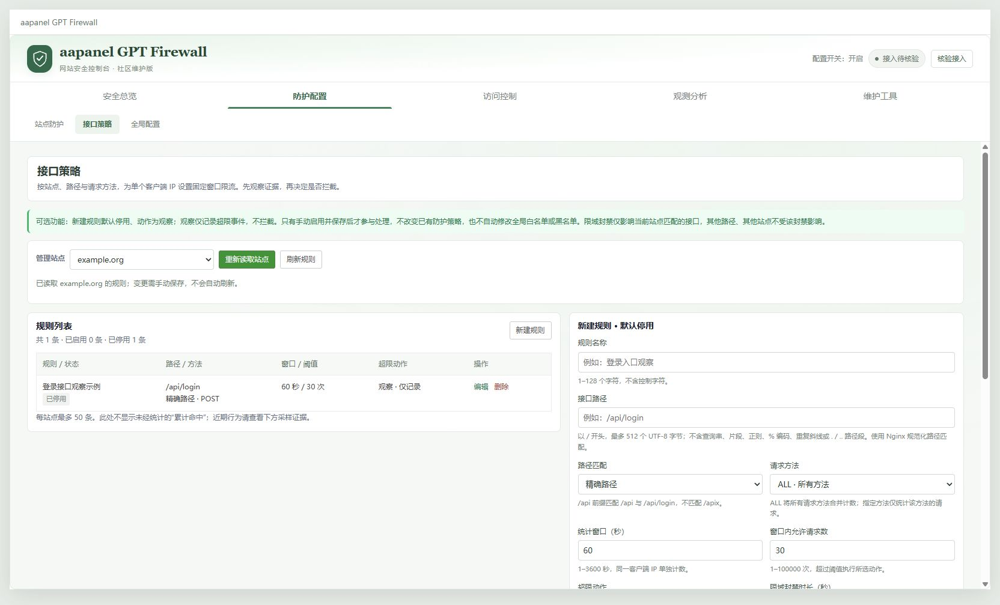

# aapanel GPT Firewall

面向**已经安装且运行数据完整的 aaPanel `free_waf 5.0` 或本社区版本**的非官方中文兼容升级，当前项目版本为 **v0.1.4**。已停用或尚未接入 Nginx 的完整旧安装也可更新代码，升级不会自动启用防护。

本项目不收费，不需要模型 API 密钥或订阅，也不通过实时语言模型判断线上请求。本版仍为实验性兼容预发布，请先在恢复出的测试环境验证。

[发布与下载](https://github.com/137985990/aapanel-gpt-firewall/releases) · [升级与恢复](docs/UPGRADE.md) · [更新管理](docs/UPDATES.md) · [更新记录](CHANGELOG.md) · [安全说明](SECURITY.md) · [问题反馈](https://github.com/137985990/aapanel-gpt-firewall/issues)

这不是 aaPanel、宝塔或 OpenAI 的官方产品。**不支持空机器首次安装，不支持直接覆盖中文 8.x 或付费 WAF。** 内部插件名仍为 `free_waf`，不要改名或并排安装第二个插件。


截图来自本仓库的隔离测试环境，样例日期以各图标注为准，不展示生产站点或真实用户。截图不是生产验收报告。

## 功能一览

| 能力 | 当前提供 | 使用边界 |
| --- | --- | --- |
| 中文总览 | 趋势、来源地图、站点排行、封禁查询 | 地图依赖面板本地资源与可用地理数据库；缺少时提示降级 |
| 分组控制台 | 顶部状态栏、五组横向导航、宽屏与小屏布局 | 原有页面入口不减少，分组仅在本次打开期间记忆页面 |
| 手动接入核验 | 检查当前宝塔 Nginx 磁盘配置中的插件入口 | 不自动执行、不重载，不证明运行中的工作进程已加载或执行 Lua |
| 原有规则管理 | IP、URL、UA、Header、Cookie、GET、POST 规则及站点例外 | 保留现有开关与阈值，不自动替换规则库 |
| CC 与注册防护 | 保留原防护；旧 CC 计数按站点和规范化路径区分，不因查询串变化重置 | 新接口策略不改变旧防护的全局封禁语义 |
| 可选接口防护 | 每站点按路径、方法和客户端 IP 设定窗口与阈值 | 新规则默认停用、动作为观察，须管理员保存启用 |
| 接口事件证据 | 查看独立日文件中的最近采样超限事件 | 已记录事件数不是总请求数或全部命中数 |
| 封禁与解封 | 人工封禁、注册封禁、接口限域临时封禁及精确 IP 解封 | 接口限域封禁不写入持久全局 IP 黑名单，最长 8 小时 |
| 网站统计 | 自然日趋势、站点、蜘蛛、客户端、访问和错误样本 | 独立 IP 不等于 UV，响应体字节不等于总流量；UA 分类不参与封禁 |
| 本地安全巡检 | 手动扫描已配置站点根目录内的普通 PHP 文件 | 限制深度、数量、读取字节和正则计算时间，不扫描任意路径，不上传样本 |
| 社区更新管理 | 固定仓库检查、摘要校验、确认安装、代码备份与失败回退 | 不静默安装；GitHub 摘要不是独立数字签名，回退不是全量事务 |

界面存在菜单不代表相应防护已启用。功能受安装配置、运行依赖、日志覆盖和现有白名单影响，不承诺零误报或零漏检。

## v0.1.4 控制台与接入状态

- 安全总览、防护配置、访问控制、观测分析、维护工具五组横向导航替代左侧长菜单；页面使用完整内容宽度，小屏保持可访问。
- 顶部显示配置开关与接入证据，开关为开不会被误写成“防护已启用”。初始两次只读请求不运行 Nginx 检查或安全巡检。
- 点击“核验接入”后，最多等待 5 秒、读取至多 2 MiB 配置检查输出；仅使用固定宝塔 Nginx，不接受命令或路径参数，不上传或返回原始配置。
- “配置已接入”仅指当前磁盘配置包含兼容入口；它不是运行时执行证明。修改接入后，应另行人工核对配置重载、工作进程和正常业务。
- 沿用下述 v0.1.3 更新修复，运行包仍为 21 个受管文件；原有配置、名单和阈值保持不变。

## v0.1.3 更新修复

- 修复完整旧安装因为缺少可选 `free_waf.conf` 接入文件而在线更新失败的问题。不创建空配置绕过检查，不自动补接入文件或开启防护；没有活动入口时不重载 Nginx。
- 继续校验既有运行数据和 Nginx 生效配置；现有接入文件为空、为符号链接、入口冲突或规则结构异常时仍拒绝升级。不支持首次安装。
- 最近更新任务展示安装阶段、退出码以及允许公开的诊断原因和资源名称，不展示原始命令输出、配置路径或敏感参数。升级成功与防护已启用分开提示。
- 保持 21 个受管文件及固定下载来源，v0.1.1、v0.1.2 可直接确认升级到本版，不改防护阈值、规则、白名单和站点配置。

## 可选接口防护怎么配置

不需要接口限流时，无须添加 `endpoint_limits`；升级不会自动为任何站点创建或启用策略，也没有硬编码的业务域名或通用安全阈值。

1. 确认全局防护和目标站点防护已启用，再进入“防护配置 → 接口策略”，明确选择已配置的站点。不要在全局 IP、UA 或 URL 白名单中为测试目标新增绕过。
2. 新建规则，填写实际接口路径与请求方法。先保留 `observe`，勾选启用并保存后才开始观察；默认未勾选的规则不会计数或记录事件。
3. 在测试环境按真实业务确定窗口和阈值，再检查“采样事件证据”的覆盖提示。观察仅记录超限事件，不拒绝请求、不创建封禁，也不增加旧规则的重试计数或攻击总数。
4. 核实正常用户、共享出口 IP、自动重试和批量任务后，再按需改为 `reject` 或 `ban` 并保存。不要把示例数字当作适合所有站点的推荐值。
5. 在测试站点确认 429 与 `Retry-After`，同时确认其他路径、其他站点和正常业务不受这条限域策略影响。需要停用时取消启用并保存；需要提前释放某个 IP 的临时状态时使用现有精确 IP 解封入口并核对结果。

策略存放在既有 `site.json` 中各站点的可选 `endpoint_limits` 列表内，每站点最多 50 条。管理端字段约定如下：

| 字段 | 含义与范围 |
| --- | --- |
| `id` | 服务端生成的 32 位小写十六进制身份；编辑保留，不可用其他站点的 ID 新建或修改 |
| `name` | 规则名称，1–128 个字符；不要填入凭据或个人信息 |
| `enabled` | 布尔值；新建默认为 `false` |
| `action` | `observe` 仅观察；`reject` 拒绝超限请求；`ban` 对匹配接口执行临时限域封禁；新建默认 `observe` |
| `match` | `exact` 精确路径，或 `prefix` 路径段前缀；不支持正则 |
| `path` | 以 `/` 开头，按 UTF-8 编码最多 512 字节；不含查询串、片段、控制字符、百分号编码或 `.` / `..` 路径段 |
| `method` | `ALL`、`GET`、`POST`、`PUT`、`PATCH`、`DELETE`、`HEAD`、`OPTIONS` |
| `window_seconds` | 整数，1–3600 秒 |
| `max_requests` | 整数，1–100000；同一站点、规则和客户端 IP 在窗口内超过此值时执行动作 |
| `ban_seconds` | 整数，1–28800 秒，即最多 8 小时；仅 `ban` 动作用于封禁时长 |

路径匹配使用 Nginx 规范化路径，不包含查询串。例如 `prefix` 的 `/api` 匹配 `/api` 和 `/api/login`，不匹配 `/apix`；前缀规则内的匹配路径共用该规则计数。更换查询参数不会获得新的计数额度。

`reject` 和 `ban` 返回通用 **HTTP 429 JSON** 与 `Retry-After`，不弹出人机验证。`ban` 只作用于该站点内匹配这条规则的接口，不等于封禁此 IP 在全部站点或其他路径的访问。原有其他规则仍可独立拦截请求；现有显式白名单优先于接口策略。

### 事件的统计口径与隐私

接口策略在既有 WAF 日志目录单独写入 `endpoint_YYYY-MM-DD.jsonl`，日期使用服务器本地自然日。日志开启时，按站点、IP 和规则，以 `window_seconds` 时长去重后采样；去重窗口从首次记录尝试开始，不等同于请求计数窗口。重复超限不会逐次落盘，无法写入时会缺失记录；读取也有文件、字节和条数上限。

因此，**已记录事件是采样证据，不是全部请求、全部超限次数或精确历史命中总数**。事件内的 `count` 只是记录当时的窗口计数，不能把多条采样事件相加当作全量访问统计。关闭日志、读取上限、磁盘写入失败等都会减少可见记录；没有事件不代表没有流量或没有超限。

事件不保存请求正文、查询串、请求头或 Cookie，但仍含 IP、站点、路径、规则名称、动作与时间，不能当作匿名数据公开。路径本身可能包含敏感标识，应限制日志访问并在反馈前脱敏。这个字段约定只针对新增接口事件，不代表旧访问日志和其他日志已经全面脱敏。

### 源码截图画廊

以下图片为隔离样例，随公开源码快照提供，**不加入兼容升级 ZIP**。安装目录中的 README 若无法显示这两张图，请查看在线仓库 README；总览图仍随升级包提供。




## v0.1.2 的安全边界

- 移除后端休眠的明文 HTTP `cjson` 下载／编译辅助代码，不在缺少依赖时联网安装。既有依赖缺失仍需停止升级。
- 停用未验证来源的远端 `cnlist` 同步，保留现有本地规则，不宣称本地地域 IP 数据会继续自动更新。
- 为 `getSpiders`、`addSpider` 增加明确返回停用结果的占位接口，不读取参数或凭据、不联网。它们在 v0.1.1 中不存在，不是本次关闭了原本可用的蜘蛛服务。
- 本地巡检只在面板已配置站点根目录内读取有界的普通 PHP 文件，拒绝越界、路径穿越、符号链接与非普通文件；无可确认的站点根目录时不扫描。部分扫描不能证明全站无恶意文件。
- 扫描文件名与规则按文本呈现，不拼接进可执行网页脚本；取消按特定文件名隐藏扫描目标的旧逻辑。正则匹配放在有超时的本地隔离子进程内，超时或覆盖不足显示“结果不完整”，不当作全站安全结论。
- 新接口策略的保存、删除、重载和失败恢复共用互斥锁；同时保存时提示重试，避免两次接口策略操作悄悄覆盖。旧配置入口与 Lua 尚未统一事务化。
- 移除旧 `security_verification` 的算术／内联 JavaScript 挑战。该旧分支把 `request_uri` 插入 JavaScript，并使用可预测算术及 IP 绕过；现在仅返回不反射 URI 的通用 429 JSON 与 `Retry-After`，不创建验证绕过状态。

旧云检测、文件上传、自动样本上传与误报参数外传在 v0.1.1 中已经停用，本版保持停用；不把这些既有保护重复列为 v0.1.2 首次修复。社区更新仍按 [固定来源与确认机制](docs/UPDATES.md) 使用联网通道，“停用旧云接口”不等于整个面板从不联网。

## 升级与恢复

| 项目 | 兼容要求 |
| --- | --- |
| 升级基础 | 已安装的 aaPanel `free_waf 5.0` 或社区版本，原规则、站点配置与运行数据完整；未接入 Nginx 时保持未启用 |
| 项目版本 | v0.1.4；上游 `5.0` 不是本项目的版本序列 |
| 内部插件名 | `free_waf`，不修改宿主商店目录或授权信息 |
| 插件／运行目录 | `/www/server/panel/plugin/free_waf` ／ `/www/server/free_waf` |
| v0.1.1、v0.1.2、v0.1.3 用户 | 可通过已有“维护工具 → 插件更新”确认升级；运行包保持原来的 21 个受管文件，不放宽旧更新器白名单 |
| v0.1 或原版用户 | 没有社区更新器时，按教程手动导入 v0.1.4，不能让不存在的更新器升级自身 |

先阅读 [升级与恢复说明](docs/UPGRADE.md)。在面板上传前独立备份插件、运行目录、宝塔 Nginx 配置和站点引用，再在测试环境验证。不要先卸载旧插件，也不要运行旧论坛安装／卸载脚本。不要让旧商店更新覆盖社区代码。

使用发布附件 `aapanel-gpt-firewall-0.1.4-upgrade.zip`，核对校验值；GitHub 自动生成的 Source code 压缩包不是面板安装包。缺少旧版 `rule.json`、运行规则、模块或库时停止，不创建空规则绕过预检。本预发布未完成对未经修改的原生 5.0 环境的恢复安装验收。

安装钩子离线使用包内代码，仅替换运行 `init.lua`，不改原规则、站点配置、黑白名单、日志或模板。它使用 `/www/server/nginx/sbin/nginx` 检查并按需重载；失败尝试恢复本次运行代码。aaPanel 在钩子前可能已覆盖插件文件，钩子无法恢复导入前的全部旧后端，不能替代上传前备份。

安装后检查 `install-status.json` 的版本、状态和回退结果，再核对 Nginx 工作进程、插件与正常业务。配置测试通过和重载信号发出不等于 Lua 已成功执行或所有站点已验收。

## 已知限制

- 规则与阈值需要按业务配置。共享出口、代理或 NAT 会让多个用户共用 IP；必须在应用侧保留鉴权、账户额度、支付校验等控制。
- 接口规则缺失、停用或无效时不生效；接口状态采用不驱逐已有项的共享内存写入，观察不会为腾出空间而驱逐旧封禁，但内存不足等计数／封禁写入失败时，这个可选功能可能放行，不能作为唯一安全边界。计数与临时封禁也不是持久全局黑名单。
- Python 与 Lua 的多进程 JSON 读改写仍有并发覆盖风险，没有跨语言事务保证。避免在升级和批量管理时交错修改配置。
- JSON、上传、较大与落盘正文的检测覆盖不完整。接口限流不解析业务语义，不等于完整 API 防护、机器人识别或全局观察模式。
- CDN 可信代理范围和源站限制需要管理员核对，不能信任任意转发头；统计 UA 分类不能验证真实蜘蛛身份。
- 删除或重排旧规则后的稳定身份迁移尚未完成。部分旧注册状态存在归属歧义时不会猜测删除；人工 IP 段规则仍沿用既有 IPv4 格式，不代表全套 IPv6 防护已经完成。
- 网站统计和本地扫描均有覆盖上限；无耗时字段时不编造耗时，无记录或无匹配不能证明没有攻击。没有源站带宽或上游抗流量攻击保证。
- 运行时共享内存、应用数据和同期无关变更不在完整自动回退范围内。匿名响应模板虽在包内，安装器不会覆盖现有定制模板。

## 来源与反馈

原作者元数据继续保留为 **民国三年一场雨**。上游来源、署名字面差异与许可边界见 [来源与权利声明](NOTICE.md)。源码可见、免费或非营利维护不等于继承代码获得 MIT、Apache 或其他再许可；本项目不暗示上游、aaPanel、宝塔或 OpenAI 背书。

普通问题通过本仓库 Issues 提交版本和脱敏复现步骤。漏洞请按 [安全反馈流程](SECURITY.md) 先建立私密渠道，不公开生产地址、密钥、真实用户数据、完整日志或可直接利用的细节。

## 本地验证

```sh
python tools/check.py
node --test tests/test_attack_charts.js tests/test_frontend_performance.js
node --test tests/test_statistics_v011.js tests/test_plugin_update_ui.js tests/test_endpoint_policy_ui.js tests/test_console_ui.js
python tools/build_release.py --output dist/local
```

Python 测试使用标准库，前端逻辑测试使用 Node.js 内置框架。Lua 回归需要 LuaJIT 与 `lua-cjson`，可通过 `FREE_WAF_LUAJIT` 指定可执行文件；缺少时不能把跳过解释为验收通过。安装器测试只使用临时目录和模拟 Nginx，不操作真实运行目录。

模拟面板将目录权限改为 600 的修复测试需要 Linux root，与实际面板导入权限一致；普通用户运行会明确跳过。应在隔离环境中以 root 运行该测试，不能把权限跳过当成通过。

构建器只复制公开文件白名单，保留源码测试与审计工具，拒绝符号链接、疑似凭据和未知输出目录覆盖；运行 ZIP 固定为兼容的 21 个文件。源码画廊图片不扩大运行包。构建成功也不代表已经发布或完成生产验收。

`tools/ci-template.yml` 是供管理员检查后启用的测试模板，默认不执行 GitHub Actions，不为本次发布扩大账户授权。
